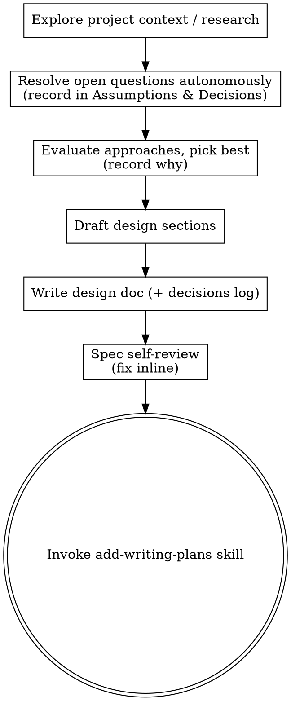

# Brainstorming Ideas Into Designs

Turn the task into a fully formed design and spec **autonomously** — you are running unattended, so you research and decide rather than interview a human.

Start by understanding the current project context and researching the problem. Resolve every open question with your own best judgment, recording each non-obvious call in an **Assumptions & Decisions** log. Then write the design directly. There is no human approval gate in this variant.

<HARD-GATE>
Do NOT invoke any implementation skill, write any code, or scaffold any project until you have written a design doc (spec) to disk. This applies to EVERY project regardless of perceived simplicity. The gate is "a spec exists," NOT "a human approved it" — you never wait for approval.
</HARD-GATE>

## Anti-Pattern: "This Is Too Simple To Need A Design"

Every project goes through this process. A todo list, a single-function utility, a config change — all of them. "Simple" projects are where unexamined assumptions cause the most wasted work. The design can be short (a few sentences for truly simple projects), but you MUST write it down before implementing.

## Checklist

You MUST create a task for each of these items and complete them in order:

1. **Explore project context** — check files, docs, recent commits; research the problem space
2. **Resolve open questions autonomously** — identify what a human would be asked (purpose, constraints, success criteria, ambiguities) and decide each yourself using project conventions and ecosystem defaults; record each decision in the Assumptions & Decisions log
3. **Evaluate 2-3 approaches** — weigh trade-offs and pick the best one; record why in the log
4. **Draft the design** — in sections scaled to their complexity (no per-section approval — you are the reviewer)
5. **Write design doc** — save to `docs/add/specs/YYYY-MM-DD-<topic>-design.md` (include the Assumptions & Decisions section) and commit
6. **Spec self-review** — inline check for placeholders, contradictions, ambiguity, scope (see below); fix inline
7. **Transition to implementation** — invoke add-writing-plans skill to create implementation plan

## Process Flow

**The terminal state is invoking add-writing-plans.** Do NOT invoke any other implementation skill. The ONLY skill you invoke after brainstorming is add-writing-plans.

## The Process

**Understanding the idea:**

- Check out the current project state first (files, docs, recent commits)
- Before asking detailed questions, assess scope: if the request describes multiple independent subsystems (e.g., "build a platform with chat, file storage, billing, and analytics"), flag this immediately. Don't spend questions refining details of a project that needs to be decomposed first.
- If the project is too large for a single spec, help the user decompose into sub-projects: what are the independent pieces, how do they relate, what order should they be built? Then brainstorm the first sub-project through the normal design flow. Each sub-project gets its own spec → plan → implementation cycle.
- For appropriately-scoped projects, enumerate the questions you would ask a human (purpose, constraints, success criteria) and answer each yourself
- For each answer, prefer the choice that matches existing project conventions, then ecosystem defaults, then the simplest thing that satisfies the goal
- Record every non-obvious answer in the Assumptions & Decisions log — that is how the human reviews your reasoning later
- Focus on understanding: purpose, constraints, success criteria

**Exploring approaches:**

- Evaluate 2-3 different approaches with trade-offs
- Pick the strongest one; record the choice and your reasoning in the log
- Do not stall on a close call — decide, note the runner-up, and move on

**Presenting the design:**

- Once you understand what you're building, draft the design directly to the spec doc
- Scale each section to its complexity: a few sentences if straightforward, up to 200-300 words if nuanced
- Do NOT stop for per-section approval — you are the reviewer in this variant
- Cover: architecture, components, data flow, error handling, testing
- If something doesn't make sense, resolve it with best judgment and record the assumption

**Design for isolation and clarity:**

- Break the system into smaller units that each have one clear purpose, communicate through well-defined interfaces, and can be understood and tested independently
- For each unit, you should be able to answer: what does it do, how do you use it, and what does it depend on?
- Can someone understand what a unit does without reading its internals? Can you change the internals without breaking consumers? If not, the boundaries need work.
- Smaller, well-bounded units are also easier for you to work with - you reason better about code you can hold in context at once, and your edits are more reliable when files are focused. When a file grows large, that's often a signal that it's doing too much.

**Working in existing codebases:**

- Explore the current structure before proposing changes. Follow existing patterns.
- Where existing code has problems that affect the work (e.g., a file that's grown too large, unclear boundaries, tangled responsibilities), include targeted improvements as part of the design - the way a good developer improves code they're working in.
- Don't propose unrelated refactoring. Stay focused on what serves the current goal.

## After the Design

**Documentation:**

- Write the design (spec) to `docs/add/specs/YYYY-MM-DD-<topic>-design.md`
  - (User preferences for spec location override this default)
- Include an **## Assumptions & Decisions** section listing every non-obvious call you made, the alternatives, and why. This log travels with the work into the plan and the final PR.
- Use elements-of-style:writing-clearly-and-concisely skill if available
- Commit the design document to git

**Spec Self-Review:**
After writing the spec document, look at it with fresh eyes:

1. **Placeholder scan:** Any "TBD", "TODO", incomplete sections, or vague requirements? Fix them.
2. **Internal consistency:** Do any sections contradict each other? Does the architecture match the feature descriptions?
3. **Scope check:** Is this focused enough for a single implementation plan, or does it need decomposition?
4. **Ambiguity check:** Could any requirement be interpreted two different ways? If so, pick one and make it explicit.

Fix any issues inline. No need to re-review — just fix and move on.

**No User Review Gate:**
This variant runs unattended — there is no human to review the spec. Once the self-review passes, proceed directly to planning. The human reviews your work later, on the finished PR (which reproduces the Assumptions & Decisions log). Do NOT stop to ask for spec approval.

**Implementation:**

- Invoke the add-writing-plans skill to create a detailed implementation plan
- Do NOT invoke any other skill. add-writing-plans is the next step.

## Key Principles

- **Decide, don't ask** - Resolve every question yourself; you are running unattended
- **Record every decision** - The Assumptions & Decisions log is how the human reviews your judgment after the fact
- **YAGNI ruthlessly** - Remove unnecessary features from all designs
- **Explore alternatives** - Weigh 2-3 approaches before settling, then commit
- **Bias to progress** - A recorded assumption beats a stalled run; never block on a question
- **Be decisive** - When something is ambiguous, pick the reasonable interpretation and make it explicit in the spec
