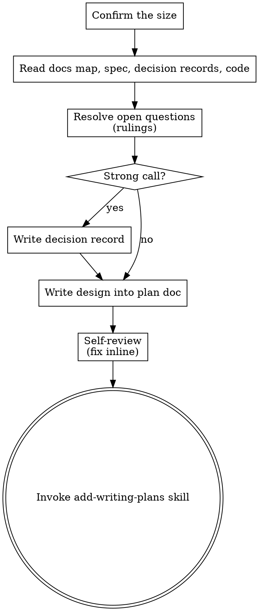

# Brainstorming Ideas Into Designs

Turn the task into a design **autonomously** — you are running unattended, so you research and rule instead of interviewing a human.

Start from the project's own docs: the spec for the feature you are changing and the decision records that touch it. Resolve every open question with your own best judgment, recording each non-obvious call as a ruling and each strong one as a decision record. Then write the design as the first half of one plan doc, which add-writing-plans completes with tasks. There is no human approval gate in this variant.

<HARD-GATE>
Do NOT invoke any implementation skill, write any code, or scaffold any project until the design is written to the plan doc on disk. This applies to EVERY bounded or architectural request regardless of perceived simplicity. The gate is "the design exists," NOT "a human approved it" — you never wait for approval.
</HARD-GATE>

## Anti-Pattern: "This Is Too Simple To Need A Design"

Only trivial requests skip this skill (a typo, a rename, a one-line fix — the router sends those straight to TDD). A change to an existing flow, a small utility, a config change: all of them get a design. "Simple" changes are where unexamined assumptions cause the most wasted work. The design can be a few sentences, but you MUST write it down before implementing.

## Checklist

You MUST create a task for each of these items and complete them in order:

1. **Confirm the size** — the router announced it; upgrade it (with a ruling) if exploration shows more
2. **Read the project's docs and code** — the docs map (add-documenting-changes), the spec for the area, decision records that touch it, the code, recent commits
3. **Resolve open questions as rulings** — identify what a human would be asked and decide each yourself
4. **Escalate strong calls to decision records** — write them now, with the options you weighed
5. **Write the design into the plan doc** — `docs/plans/YYYY-MM-DD-<topic>.md`, or the project's plans folder
6. **Self-review** — inline check, fix in place (see below)
7. **Transition to planning** — invoke add-writing-plans skill to add the tasks

## Process Flow

**The terminal state is invoking add-writing-plans.** Do NOT invoke any other implementation skill. The ONLY skill you invoke after brainstorming is add-writing-plans.

## The Process

**Understanding the idea:**

- Read before you rule: the feature's spec (what it does now), accepted decision records that touch the area, the code, and recent commits. Use an Explore subagent for broad sweeps. Do not rule on anything the repo already answers.
- A spec or accepted decision record binds the design. Behavior the request asks to change goes into the spec delta. Anything else it settles (a non-goal, a constraint, an accepted record) is followed, or superseded with a new decision record. Never design around it silently.
- Before going deep, assess scope: if the request describes multiple independent subsystems (e.g., "build a platform with chat, file storage, billing, and analytics"), decompose it, design only the first sub-project, and record the rest under `## Deferred` as follow-up runs. Each sub-project gets its own plan → implementation cycle.
- For appropriately-scoped work, enumerate the questions you would ask a human (purpose, constraints, success criteria, edge cases) and answer each yourself
- For each answer, prefer the choice that matches existing project conventions, then ecosystem defaults, then the simplest thing that satisfies the goal
- Keep what the user said apart from what you assumed: the design states both

**Rulings and decision records:**

- Each non-obvious answer is a ruling in the plan's `## Rulings`: `[scope] decision — why — cost if wrong: low|medium|high, what breaks`. The human reads these costliest first on the PR, so state the cost honestly.
- A call that is hard to reverse or sets direction (add-documenting-changes lists the triggers: data model, new dependency, public interface, security, pricing, a departure from a record) becomes a decision record, written now, in the project's decisions folder. Link it from the plan's `## Decisions`.
- Do not stall on a close call: decide, name the runner-up, move on.

**Choosing the approach:**

- Weigh the real alternatives, pick the strongest, and name the runner-up with one sentence on why it lost. For a strong call, the decision record's options section carries that comparison.
- Do not invent alternatives to fill a list; one approach plus the real runner-up is enough.

**Writing the design:**

- Write directly into the plan doc. Scale each section to its complexity: a few sentences if straightforward, up to 200-300 words if nuanced.
- Cover: architecture, components, data flow, error handling, testing.
- Do NOT stop for per-section approval — you are the reviewer in this variant.

**Design for isolation and clarity:**

- Break the system into smaller units that each have one clear purpose, communicate through well-defined interfaces, and can be understood and tested independently
- For each unit, you should be able to answer: what does it do, how do you use it, and what does it depend on?
- Can someone understand what a unit does without reading its internals? Can you change the internals without breaking consumers? If not, the boundaries need work.
- Clear interfaces are also what let the plan build units in parallel: a consumer can be built and tested against a producer's contract before the producer exists.
- Smaller, well-bounded units are also easier for you to work with - you reason better about code you can hold in context at once, and your edits are more reliable when files are focused. When a file grows large, that's often a signal that it's doing too much.

**Working in existing codebases:**

- Explore the current structure before proposing changes. Follow existing patterns.
- Where existing code has problems that affect the work (e.g., a file that's grown too large, unclear boundaries, tangled responsibilities), include targeted improvements as part of the design - the way a good developer improves code they're working in.
- Don't propose unrelated refactoring. Stay focused on what serves the current goal.

## The Plan Doc (Design Half)

Save to `docs/plans/YYYY-MM-DD-<topic>.md` (the project's plans folder if its docs map names one; user preferences override). Copy the project's `_template.md` if it has one, else add-documenting-changes' `templates/plan.md`. Frontmatter: `title`, `description`, `status: draft`, `date`, `size`, `specs`.

| Section | What goes in it |
|---------|-----------------|
| Intent | The problem, who has it, the evidence; what the user asked vs. what you assumed |
| Acceptance criteria | Checkable outcomes; each one becomes a test |
| Non-goals | Reasonable things this change leaves out — the fence that stops scope creep |
| Design | Approach, components, data flow, error handling, testing; the runner-up and why it lost |
| Spec delta | Per spec file, numbered items (D1, D2, ...): ADDED / MODIFIED / REMOVED behavior statements, worded as the spec will read once shipped. A new feature's delta is its whole spec. Tasks cite these numbers instead of repeating the text; acceptance-criteria lines name the test (from the task) that proves them. |
| Docs impact | Other docs this makes stale: guides, README, changelog line, pricing, marketing |
| Decisions | Decision records created or superseded, linked |
| Rulings | Every non-obvious call, one line each |
| Deferred | Sub-projects or items left for later, with why |

Do not touch the spec files themselves: the spec delta ships in the same commits as the code that makes it true. Do not commit yet either: add-writing-plans appends the tasks, then the plan and the decision records written now go in one commit before any code.

**Self-Review:**
After writing the design, look at it with fresh eyes:

1. **Placeholder scan:** Any "TBD", "TODO", incomplete sections, or vague requirements? Fix them.
2. **Internal consistency:** Do any sections contradict each other? Does the architecture match the feature descriptions?
3. **Scope check:** Is this focused enough for a single plan, or does it need decomposition?
4. **Ambiguity check:** Could any requirement be interpreted two different ways? If so, pick one and make it explicit.
5. **Testability:** Is every acceptance criterion checkable by a test?
6. **Docs:** Does the spec delta match the design? Does anything contradict an accepted decision record without a superseding one? Does every strong call have a record and every other non-obvious call a ruling with a cost?

Fix any issues inline. No need to re-review — just fix and move on.

**No User Review Gate:**
This variant runs unattended — there is no human to review the design. Once the self-review passes, proceed directly to planning. The human reviews your work later, on the finished PR, which lists every ruling costliest first and links every decision record. Do NOT stop to ask for approval.

**Implementation:**

- Invoke the add-writing-plans skill to add the tasks to the plan doc
- Do NOT invoke any other skill. add-writing-plans is the next step.

## Key Principles

- **Decide, don't ask** - Resolve every question yourself; you are running unattended
- **Record every call** - Rulings for the small ones, decision records for the strong ones
- **Specs bind** - Follow them or supersede them on the record; never silently
- **YAGNI ruthlessly** - Remove unnecessary features from all designs; put the rest in Non-goals
- **One approach, one runner-up** - Weigh real alternatives, commit to one, name what lost
- **Bias to progress** - A recorded ruling beats a stalled run; never block on a question
