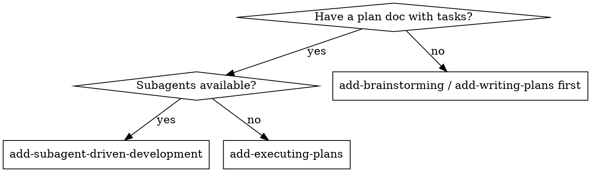
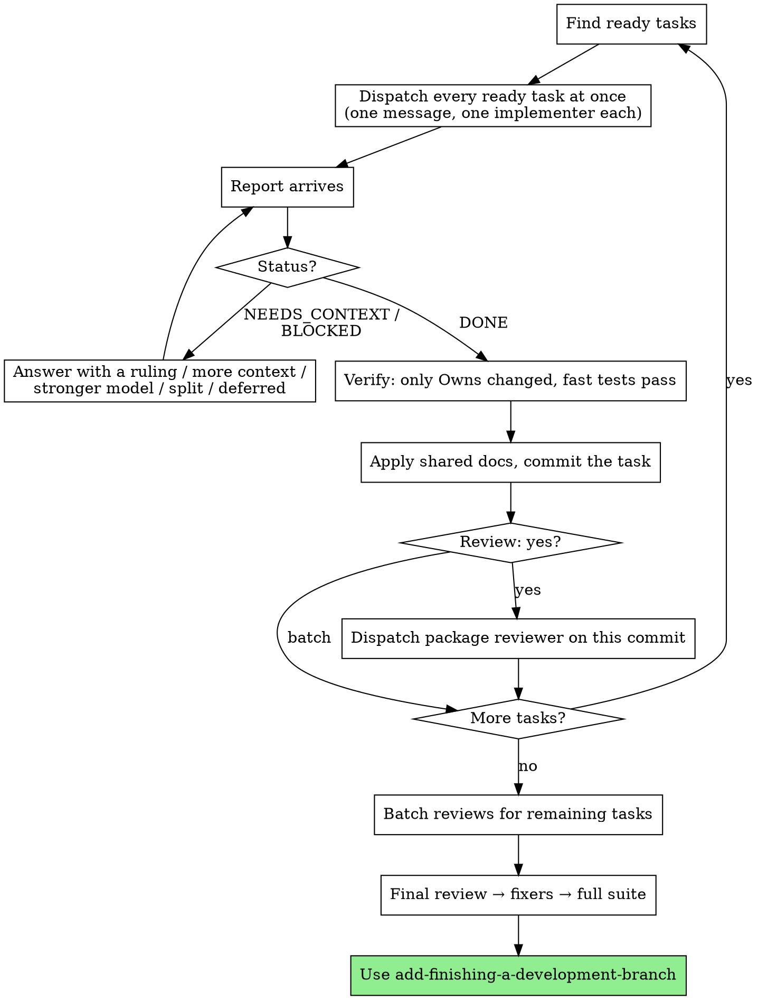

# Subagent-Driven Development

You are the coordinator. You dispatch, rule, verify, and commit; subagents implement, review, and fix. Every ready task runs at once on a fresh subagent matched to its difficulty, every finished task becomes one atomic commit (code, tests, and docs), risky tasks are reviewed as they land, and a fresh final reviewer reads the whole change before the PR.

**Why subagents:** You delegate tasks to agents with isolated context. By crafting their instructions precisely, you keep them focused and let independent tasks run side by side. They never inherit your session's history — you construct exactly what they need — which also preserves your own context for coordination.

**You never edit product code or tests yourself.** Every code change goes to an implementer or a fixer subagent, so each change gets a fresh pair of eyes and your context stays on the plan. You do edit the plan doc (rulings, deferred items) and the shared docs the plan assigns you (the feature spec, the changelog) when you commit a task.

**Continuous execution:** Do not pause to check in with a human between tasks. Execute all tasks from the plan without stopping. The only reasons a task stops are an external blocker (recorded as deferred) or all tasks complete. "Should I continue?" prompts and progress summaries have no reader — execute the plan.

## When to Use



## Setup

1. Confirm you are on this leaf's own branch (the router ran add-using-git-worktrees before brainstorming). If the plan commit landed on the base branch, that is a defect: create the leaf branch at the current HEAD (it carries the plan commit), switch to it, and record a ruling naming the stray commit on the local base branch. Never reset or force-push the base branch. Never build on main/master; this is unattended, so don't ask.
2. Read the plan doc once. Extract every task block with its full text, the Spec delta items its Docs fields cite, the Tasks header (verify commands, global constraints), and the rulings so far. Create a todo per task (TodoWrite, or the harness's task list).
3. Note the start SHA: the parent of the plan commit, so the final review's range includes the plan and its decision records.

## The Loop



1. **Find ready tasks:** every task whose `Depends on` tasks are committed and whose Owns overlap no task still in flight or under review.
2. **Dispatch them all at once:** one message, one subagent call per ready task, using `./implementer-prompt.md`. Paste the task's full text, the global constraints, the rulings that touch it, and the Produces lines (with `e.g.` values) of what it consumes. Never make an implementer read the plan file.
3. **Handle each report as it arrives** (statuses below). For a DONE task:
   - **Verify the scope:** `git status --porcelain` shows changes only in this task's Owns (other in-flight tasks' files are expected; they are not this task's). Generated files (caches, build output) don't count: never commit them, and record a ruling if the repo's `.gitignore` misses them. Any other change outside every Owns list is a defect: send it back to the implementer with the path.
   - **Verify the evidence:** run the task's fast tests yourself (in the background when the harness supports it). The report is a claim; the output is evidence (add-verification-before-completion).
   - **Apply its shared docs:** paste the task's planned text into the shared docs exactly, where its Docs field says (the Spec delta items it cites, the changelog line). If the implementer reported that the planned text no longer matches what was built, fix the text to match the code and record a ruling.
   - **Record what the implementer decided:** each assumption its report lists becomes a ruling in the plan (a decision record, if it hits a strong trigger).
   - **Commit it:** stage by path — `git add -- <Owns paths> <shared docs it touched> <plan doc, if rulings changed>` — and commit with the task's Commit message. One task, one commit. Never `git add -A` or `git commit -a`: other tasks' work is in the tree.
   - Mark the TodoWrite item complete and go back to step 1 in the same turn.
4. **Reviews:**
   - `Review: yes` tasks get a package reviewer (`./package-reviewer-prompt.md`) on their commit as soon as it lands, dispatched in the same message as the next implementers.
   - `Review: batch` tasks get one package reviewer per package or component, once all of its tasks are committed.
   - A reviewer fixes its own findings with regression tests and reports a closed list. It returns corrections to shared docs (the feature spec, the changelog) as text instead of editing them, because you may be staging those files for another task. Run the covering tests, apply its doc text, then commit its fixes as one atomic `fix(<scope>): ...` commit — code, tests, and doc corrections together. Its files are off-limits to new dispatches until it reports.
5. **Final review**, once every task and package review is committed:
   - Start the full suite (in the background when supported).
   - Dispatch a fresh final reviewer (`./final-reviewer-prompt.md`, most capable model) with the plan path, the start SHA..HEAD range, the suite result, and any open items. It reports findings only.
   - Route each finding to a fixer (`./fixer-prompt.md`) by tier, splitting by file so no two fixers share a file. Apply any shared-doc text a fixer returns, then commit each fixer's work atomically.
   - Re-run the full suite. Green → set the plan's `status: done`, commit it with the final rulings, and use add-finishing-a-development-branch.

## Model Selection

Use the least powerful model that can handle each role to conserve cost and increase speed.

| Role | Model |
|------|-------|
| `mechanical` tasks (fully specified, 1-2 files, exact tests, tests run only their own code) | Fast, cheap model |
| `design` tasks (integration, judgment, multi-file) | Standard model |
| Package reviewers | Standard model |
| Final reviewer | Most capable model |
| Fixers | Tier 1 and 2: standard model · Tier 3: most capable model |
| You, the coordinator | Whatever the session runs; you plan and judge, you don't type code |

A mechanical task that comes back NEEDS_CONTEXT, BLOCKED, or red is never retried on the cheap model: re-dispatch it on the standard model and record a ruling.

## Handling Implementer Status

Implementer subagents report one of four statuses. Handle each appropriately:

**DONE:** Verify, apply shared docs, commit (step 3 above).

**DONE_WITH_CONCERNS:** The implementer completed the work but flagged doubts. Read the concerns before committing. Correctness or scope concerns: resolve them first (send back, or rule). Observations ("this file is getting large"): record a ruling if it matters, then commit.

**NEEDS_CONTEXT:** The implementer needs information that wasn't provided. If the plan answers it, paste the answer. If the plan is silent, decide, record a ruling, and answer the same implementer with it — except a `mechanical` task, which is re-dispatched on the standard model with the answer (see Model Selection). If the answer is a strong call (add-documenting-changes lists the triggers), also write the decision record, link it from the plan's `## Decisions`, pass it to the implementer, and stage it with that task's commit.

**BLOCKED:** The implementer cannot complete the task. Assess the blocker:
1. If it's a context problem, provide more context and re-dispatch with the same model
2. If the task requires more reasoning, re-dispatch with a more capable model
3. If the task is too large, split it into smaller tasks in the plan doc (record the ruling) and dispatch them
4. If the plan itself is wrong, fix the plan yourself (amend the plan doc, record a ruling — or a decision record, if the fix is a strong call) and re-dispatch — you are unattended, so do not wait for a human. Only a true external blocker (missing credential/service/network) is unrecoverable: record it under `## Deferred`, skip or stub that task, and continue the rest of the plan.

**Never** ignore a blocker or force the same model to retry without changes. If the implementer said it's stuck, something needs to change. **Never** halt the whole run waiting for input — decide, record, and keep moving.

## Fixing

| Tier | Use when | Model |
|------|----------|-------|
| 1 | Cause known; fix confined to one module | Standard model |
| 2 | Cause known; fix spans modules or a seam between tasks | Standard model, told to reason carefully |
| 3 | Cause unknown and needs diagnosis, or a lower tier failed twice | Most capable model, with add-systematic-debugging |

After two failed rounds at a tier, move up one. Each new round gets a fresh fixer whose brief carries the finding plus the previous round's report (what changed, what failed, the evidence) — never a pasted transcript. Findings still open after tier 3 become rulings with `cost if wrong: high` and go in the PR.

## Prompt Templates

- `./implementer-prompt.md` - Dispatch an implementer for one task
- `./package-reviewer-prompt.md` - Dispatch a reviewer-fixer for one task or a batch
- `./final-reviewer-prompt.md` - Dispatch the fresh, findings-only final reviewer
- `./fixer-prompt.md` - Dispatch a fix-only subagent for named findings

## Example Workflow

```
You: I'm using Subagent-Driven Development to execute this plan.

[Read plan once: docs/plans/2026-10-25-free-tier-cap.md]
[Extract T1-T5 with full text; TodoWrite; start SHA = the plan commit's parent]

Ready: T1 (plans catalog, no deps), T2 (limits, consumes T1 via e.g. values),
       T3 (API error mapping, mechanical). All Owns disjoint.
[One message: three implementer dispatches — T1 standard, T2 standard, T3 cheap]

T3 reports DONE: owns src/api/errors.py + tests; 6/6 passing.
  [git status: only T3's Owns changed besides T1/T2 in-flight files]
  [run T3's fast tests: 6 passed]
  [no shared docs; git add -- src/api/errors.py tests/api/test_errors.py]
  [git commit -m "feat(api): map cap errors to 402 with upgrade_url" ...]

T2 reports NEEDS_CONTEXT: "Do archived projects count toward the cap?"
  [Plan is silent. Ruling: [billing] archived projects don't count — users expect
   archiving to free a slot — cost if wrong: medium, cap is looser than intended]
  [Answer T2 with the ruling]

T1 reports DONE. [verify, commit "feat(billing): add plan limits catalog"]
  Ready now: T4 (depends on T1). [dispatch T4]

T2 reports DONE: Review: yes (concurrent creates).
  [verify; apply shared docs: spec delta slice into docs/specs/billing.md,
   changelog line into CHANGELOG.md]
  [git add -- src/billing/limits.py tests/billing/test_limits.py docs/specs/billing.md CHANGELOG.md docs/plans/2026-10-25-free-tier-cap.md]
  [commit "feat(billing): cap free plan at 3 projects" with Spec/Decision/Plan lines]
  [same message: package reviewer on T2's commit]

Package reviewer: 1 finding fixed — race between count and insert; added
  test_concurrent_creates_respect_cap; FIXED. [run test, commit fix(billing): ...]

...T4, T5 committed; batch review of the API package: approved...

[Full suite in background; fresh final reviewer on plan + start..HEAD]
Final reviewer: CHANGES_REQUESTED
  docs/specs/billing.md:14 - says "projects" but code counts workspaces - align wording - tier 1
[Fixer tier 1 fixes the spec line; commit "docs(billing): align cap wording with code"]
[Full suite: green. Plan status: done. → add-finishing-a-development-branch]
```

## Advantages

**vs. one task at a time:**
- Independent tasks run side by side; the graph decides how wide the build goes
- Each implementer gets exactly its task, its contracts, and its fakes — no waiting on producers

**vs. executing plans inline:**
- Fresh context per task; your context stays on coordination
- Every commit stays atomic: one task, its tests, and its docs, in the order tasks finish

**Quality gates:**
- TDD in every task, evidence checked by you before each commit
- Risky tasks reviewed as they land; the rest reviewed per batch
- A fresh, findings-only final reviewer reads the whole change, including whether the docs tell the truth
- Fixers are tiered by how well the cause is understood

**Cost:**
- One implementer per task, a reviewer per risky task or batch, one final reviewer, fixers as needed
- The plan has to be written for the split (add-writing-plans) — that up-front work is what makes parallel execution safe

## Red Flags

**Never:**
- Edit product code or tests yourself — send it to an implementer or fixer
- Let a subagent run git commands that change state (add, commit, stash, checkout, switch, reset, restore) — you commit, one task per commit; read-only `status`, `diff`, `log`, and `show` are fine
- `git add -A` or `git commit -a` while any task is in flight
- Dispatch two tasks whose Owns overlap, or dispatch into files a reviewer holds
- Commit a task without its shared docs (spec slice, changelog line) — the commit is the unit of truth
- Commit on a report without running the task's tests yourself
- Make an implementer or fixer read the plan file (paste its task text instead; reviewers get the plan path)
- Skip scene-setting context (a subagent needs to know where its task fits)
- Leave a subagent's question unanswered — answer it, with a ruling if the plan is silent
- Accept "close enough" from a reviewer, or move on while its findings are open
- Skip the final review, or let the final reviewer fix things itself
- Start implementation on main/master — auto-create a feature branch instead (unattended; don't ask)
- Halt the run waiting for input

**If a subagent fails a task:**
- Dispatch a fresh implementer or fixer with specific instructions and the failure evidence
- Don't fix it yourself (context pollution, and no fresh eyes)

## Integration

**Required workflow skills:**
- **add-writing-plans** - Creates the plan this skill executes
- **add-documenting-changes** - Shared docs, rulings, decision records, and the atomic commit
- **add-verification-before-completion** - Evidence before each commit and before the PR
- **add-finishing-a-development-branch** - Push and open the PR after the final review

**Subagents should use:**
- **add-test-driven-development** - Every implementer and fixer follows TDD
- **add-systematic-debugging** - Tier 3 fixers diagnose with it

**Optional / conditional:**
- **add-using-git-worktrees** - Isolation per leaf, default on in this variant
- **add-requesting-code-review** - Ad-hoc reviews outside the plan's own

**Alternative workflow:**
- **add-executing-plans** - Same plan, executed inline, when subagents are unavailable
