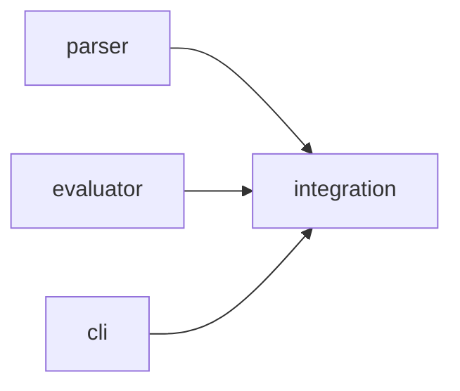

# Writing Plans

## Overview

Complete the plan doc add-brainstorming started by adding the tasks: a graph of contracts that fresh implementers can build in parallel without asking questions. Each task owns its files, names the interfaces it consumes and produces, carries its tests and its docs, and ends in exactly one atomic commit. Assume the implementer is a skilled developer who knows almost nothing about this codebase, toolset, or problem domain, and not much about good test design.

**Announce at start:** "I'm using the add-writing-plans skill to add the tasks to the plan."

**Plan doc:** the same `docs/plans/YYYY-MM-DD-<topic>.md` (or the project's plans folder). Called without a design? Write the design sections first (add-brainstorming lists them), then the tasks.

## Scope Check

If the design covers multiple independent subsystems, it should have been decomposed during brainstorming. If it wasn't, plan the first subsystem and record the rest under `## Deferred`. Each plan should produce working, testable software on its own.

## File Structure

Before defining tasks, map out which files will be created or modified and what each one is responsible for. This is where decomposition decisions get locked in.

- Design units with clear boundaries and well-defined interfaces. Each file should have one clear responsibility.
- You reason best about code you can hold in context at once, and your edits are more reliable when files are focused. Prefer smaller, focused files over large ones that do too much.
- Files that change together should live together. Split by responsibility, not by technical layer.
- In existing codebases, follow established patterns. If the codebase uses large files, don't unilaterally restructure - but if a file you're modifying has grown unwieldy, including a split in the plan is reasonable.

## Check the Verify Commands First

Before writing any task, run the project's fast and full test commands once. A documented command that fails as written (runner not installed, import path wrong) would hand every implementer a broken check: find the form that works here (`uv run`, the project's virtualenv, `npx`, a `PYTHONPATH`), record a ruling, and put that form in the header. Note which tests already fail.

## Tasks Section Header

Write this under `## Tasks`, after the design sections:

```markdown
## Tasks

> **For agentic workers:** REQUIRED SUB-SKILL: add-subagent-driven-development (add-executing-plans only without subagents). The coordinator commits each task; implementers never run git.

**Goal:** [One sentence]
**Architecture:** [2-3 sentences]
**Tech stack:** [Key technologies/libraries]
**Detail:** tests            (contracts | tests | full)
**Verify:** fast `[command that runs the given test files]` · full `[whole suite]` (both checked to work)
**Global constraints:** [exact values every task obeys: versions, names, formats, error shapes]
```

Task blocks point at the global constraints instead of repeating them.

## The Task Graph

Architectural plans include a Mermaid graph with one edge per line under a `%% taskgraph` comment. **An edge means Tm's tests run Tn's code** — nothing else. A name, route, or flag that the contract already states is not an edge.



Here T1, T2, and T3 run at once: the evaluator and CLI test against fakes built from the parser's contract, and T4 runs the real pieces together. Include the graph whenever two or more tasks can run at once; a plan whose tasks form one chain can rely on each task's `Depends on`.

## Task Block

````markdown
### T3: Free-tier project cap · design · standard model

**Owns:** `src/billing/limits.py`, `tests/billing/test_limits.py`
**Depends on:** T1
**Consumes:** `Plan.limits(plan_id: str) -> Limits` (T1)
**Produces:** `check_project_cap(account: Account) -> CapResult`
  e.g. `check_project_cap(account_with(plan="free", projects=3))` -> `CapResult(allowed=False, limit=3)`
  e.g. `check_project_cap(account_with(plan="pro", projects=40))` -> `CapResult(allowed=True, limit=None)`
**Tests:** fast
**Review:** yes — two concurrent creates must not both pass the cap
**Docs:**
- `docs/specs/billing.md` (shared): D2 (Spec delta), under `## Behavior` after the line starting "A free account"
- `CHANGELOG.md` (shared): under `### Added`: "Free plan is limited to 3 projects."
**Decision:** `docs/decisions/0007-cap-free-tier-at-3-projects.md`
**Notes:** only what the contract doesn't say: an ordering, a tie-break, a small change to existing code the steps rely on

**Test code:**
```python
def test_free_account_blocked_at_cap():
    result = check_project_cap(account_with(plan="free", projects=3))
    assert result == CapResult(allowed=False, limit=3)
```

**Steps:** 1 write the failing tests · 2 run them, expect FAIL (`check_project_cap` not defined) · 3 write the minimal code · 4 run them, expect PASS · 5 refactor, still green

**Commit:** `feat(billing): cap free plan at 3 projects` — body: why, then `Spec:`, `Decision:`, `Plan:` lines
````

| Field | Rule |
|-------|------|
| Title | `T<n>: <name> · <kind> · <model tier>` |
| Owns | Exact paths, including tests and any doc only this task touches. Two tasks that can run at once never share a path. A task that needs a small change in a file another task owns either moves that change into the owning task or takes the file and depends on it. |
| Depends on | Execution dependencies only, or `none`. |
| Consumes / Produces | Exact names, parameter and return types. Under every Produces that another task consumes and that returns structured data, 1-3 `e.g.` lines with concrete values: the consumer's fake returns exactly these, and the producer's tests assert them. |
| Kind and model tier | `mechanical` (fully specified: ≤150 lines, ≤2 components, fast tests, every test named with exact inputs and outputs, and its tests run only its own code) → fast, cheap model. Otherwise `design` → standard model; integration tasks are always `design`. Never plan a task for the most capable model; split it instead. That model coordinates and reviews. |
| Tests | `fast` or `slow`. Slow means seconds per test: servers, browsers, network, real databases. Temp files and short subprocesses are fast. Implementers run only fast tests; slow suites run once after the commit. |
| Review | `yes` + the risk, for seams between tasks, security, concurrency, money, data migrations, and tricky algorithms. Otherwise `batch`. |
| Docs | Every doc the task makes true or stale, with where it goes (the section, or the line it follows). Spec text is cited by its Spec delta number (D2), never retyped; other text is given exactly. A doc more than one task touches (the feature spec, `CHANGELOG.md`) is **shared**: the coordinator applies the task's text when it commits the task. A doc only this task touches goes in Owns and the implementer writes it. Write `none` only for changes with no behavior or docs impact, and say why. |
| Decision | Decision records this task implements, or `none`. |
| Notes | Optional. Only non-obvious detail: an ordering, a tie-break, a small change to existing code. |
| Test code | Per the Detail level. Include the error and edge cases the design implies, and the Review risk as a named test. |
| Commit | One task, one commit. Conventional Commits subject; body per add-documenting-changes. No commit step in Steps: the coordinator commits. |

## Write for Parallel Work

1. **Producers first.** Write producer tasks, with exact Produces lines, before the tasks that consume them. A consumer whose contract is complete can be built the moment it is written, even while its producer is still in progress.
2. **Fakes, not waiting.** Consumers test against small fakes that return the producer's `e.g.` values. One integration task per package, at the end, runs the real pieces together; it owns the wiring that connects them (the composition root, the CLI entry point), so its tests fail until that wiring exists. A chain like parser → evaluator → workbook → CLI becomes four parallel tasks plus one integration task.
3. **Size every task for 2-5 minutes of implementer work.** Anything that looks bigger is two tasks from the start: split along components (server / UI, engine / CLI), not into "part 1" and "part 2".
4. **Fewest edges.** Draw an edge only when a task's tests execute another task's code. Order tasks so the ones without edges come first.
5. **Mark the easy ones.** A task that meets the mechanical rules gets `mechanical` and the fast, cheap model when you write it.
6. **Docs ride with their code.** A behavior's spec text lands in the commit of the task that ships the behavior. A docs-only task (a tutorial over finished features) depends on the tasks it describes.
7. **Finish each block before starting the next.** No half-written tasks; a block with a placeholder blocks everything with an edge to it.

## Detail Levels

- **contracts:** every test named, with exact inputs and expected outputs; no code.
- **tests** (default): test code verbatim and runnable as written; no implementation code. Code the implementer would write anyway costs planning time and invites transcription errors.
- **full:** test code plus the implementation approach in code — only for algorithmic or risky cores. `**Detail:** full` on one task overrides the header.

## Plan Size

Keep the whole plan doc under about 15,000 characters (`wc -c`). The plan is written before any agent can start, so every extra page delays the whole build. Keep the contracts, the `e.g.` lines, the graph, and the test code for tricky cores; switch simple tasks to `contracts` detail; cite spec text by number instead of repeating it. Drop the template's guidance comments as you fill each section.

## No Placeholders

Every task must contain what an implementer needs. These are **plan failures** — never write them:
- "TBD", "TODO", "implement later", "fill in details"
- "Add appropriate error handling" / "add validation" / "handle edge cases"
- "Write tests for the above" (without the tests, at the plan's Detail level)
- "Similar to Task N" (repeat it — the implementer reads only their own task)
- A Docs field that says "update the docs" without the text
- References to types, functions, or methods that no task produces

## Self-Review

After writing the tasks, check the plan against the design with fresh eyes. This is a checklist you run yourself — not a subagent dispatch.

1. **Coverage:** Every acceptance criterion, spec delta line, docs impact item, and decision record maps to a task. List gaps and add tasks for them.
2. **Placeholders:** Search for the patterns above. Fix them.
3. **Type consistency:** Every Consumes line matches a Produces line, name and types. `clearLayers()` in T3 and `clearFullLayers()` in T7 is a bug.
4. **Graph:** No cycles; every edge is an execution dependency; no two tasks that can run at once share an Owns path.
5. **Fields:** Every task has Owns, Depends on, Tests, a kind and model tier, Review, Docs, and Commit.
6. **Size:** No task looks over about 6 minutes of implementer work, and the plan is under about 15,000 characters.
7. **Verify:** The header's commands were run and work as written.

Fix issues inline. No need to re-review — just fix and move on.

## Commit the Plan

Set the plan's `status: in-progress` (this variant uses `draft` → `in-progress` → `done`; `approved` is for human-gated workflows) and commit it with the decision records written during design, before any code: `docs(plan): <topic>`. Commit on this leaf's branch, which add-using-git-worktrees created before brainstorming — never on the base branch. This is the one docs-only commit the change starts with; every later commit carries its own code, tests, and docs.

## Execution Handoff

This variant runs unattended — do NOT offer an execution choice or wait for input. After committing the plan, proceed **directly** to execution:

- **REQUIRED SUB-SKILL:** Use add-subagent-driven-development — the coordinator dispatches ready tasks in parallel and commits each one atomically.
- Only fall back to add-executing-plans if subagents are unavailable in this environment.

Announce briefly (e.g. "Plan committed to `docs/plans/<filename>.md`. Executing via add-subagent-driven-development.") and continue — no question, no pause.
