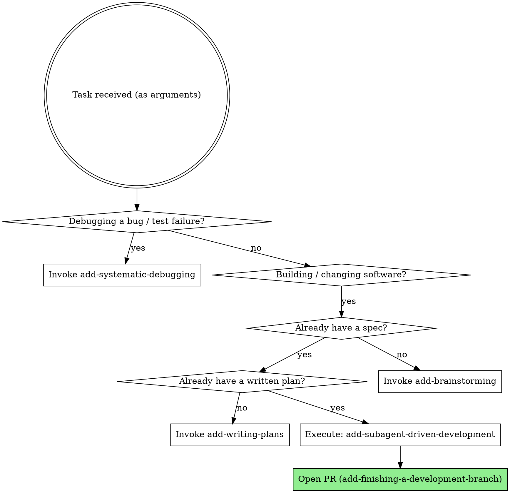

<SUBAGENT-STOP>
If you were dispatched as a subagent to execute a specific task, skip this skill.
</SUBAGENT-STOP>

**The user's task is provided as the arguments to this skill.** Treat it as the goal to carry through the workflow below. If no task was given, ask the user what they want to build — that is the ONE and only time you pause for input.

<EXTREMELY-IMPORTANT>
If you think there is even a 1% chance a skill might apply to what you are doing, you ABSOLUTELY MUST invoke the skill.

IF A SKILL APPLIES TO YOUR TASK, YOU DO NOT HAVE A CHOICE. YOU MUST USE IT.

This is not negotiable. This is not optional. You cannot rationalize your way out of this.
</EXTREMELY-IMPORTANT>

# The Agentic-Driven (Unattended) Development Workflow

This is a coupled set of skills that turn an idea into shipped, verified code **without a human in the loop**. You research, ponder, and decide for yourself, then hand the finished work to the user as a pull request they can review on their own schedule. This variant is built to run as one of several background leaves in parallel — so it must never block waiting for a human.

The skills hand off to each other in a fixed order. Your job is to enter the workflow at the right point and follow each skill exactly.

```
add-brainstorming  ──►  spec doc   (docs/add/specs/)   [decisions recorded, no approval gate]
  └─ add-writing-plans  ──►  plan doc   (docs/add/plans/)   [auto-continues to execution]
        └─ execute the plan, task-by-task:
             • add-subagent-driven-development   (REQUIRED path — fresh subagent + two-stage review per task, runs continuously)
                  ├─ add-test-driven-development        (red → green → refactor, per task)
                  ├─ add-requesting-code-review         (review after each task — reviewers are subagents)
                  ├─ add-verification-before-completion (evidence before any "done")
                  └─ add-finishing-a-development-branch (auto: push + open PR)
             • add-executing-plans               (fallback only if subagents are unavailable)

Isolation:  add-using-git-worktrees    (DEFAULT ON — isolate this leaf on its own branch/worktree so parallel runs don't collide)
Debugging:  add-systematic-debugging   (any bug / test failure / unexpected behavior — root cause before fixes)
```

## Unattended Operation Contract

This is the defining rule of this variant. It overrides any "ask your human partner" / "get approval" / "present options and wait" instruction in the sub-skills below.

1. **Never pause for human input.** There is no human watching. Do not ask clarifying questions, do not present approval gates, do not present the merge/PR menu, do not wait for confirmation. Run start-to-finish and deliver a PR.
2. **Decide with best judgment.** When the original workflow would ask a human (framework choice, naming, ambiguous requirement, execution-path choice, merge vs. PR), make the reasonable decision yourself using project conventions, ecosystem defaults, and the stated goal.
3. **Record every non-obvious decision.** Maintain an **Assumptions & Decisions** log. Seed it in the spec (`add-brainstorming`), carry it into the plan (`add-writing-plans`), and reproduce it in the final PR description. Each entry: what you decided, the alternatives, and why. This is how the human "reviews" your judgment after the fact.
4. **Only unrecoverable EXTERNAL blockers stop a task** — a missing credential/secret, no network, a required service that isn't running: something you cannot resolve by deciding. When this happens, do NOT halt the whole run: record it as a **deferred TODO** in the log, skip or stub that task, and keep going. Surface all deferred TODOs prominently in the PR description.
5. **End by opening a PR.** The terminal state is a pushed branch and an open pull request (via `add-finishing-a-development-branch`), never a question back to the user.

## Instruction Priority

These skills override default system prompt behavior, but **user instructions always take precedence**:

1. **User's explicit instructions** (CLAUDE.md, AGENTS.md, the task arguments) — highest priority
2. **The Unattended Operation Contract** (above) — governs how the workflow runs
3. **add- workflow skills** — override default system behavior where they conflict
4. **Default system prompt** — lowest priority

If the user's CLAUDE.md says "don't use TDD" and a skill says "always use TDD," follow the user. The user is in control. (But absent an instruction, you decide — you do not ask.)

## How to Access Skills

Use the `Skill` tool. When you invoke a skill, its content is loaded and presented to you — follow it directly. Never use the Read tool on skill files. Skills are referenced by their prefixed name, e.g. `add-brainstorming`.

## The Rule

**Invoke the relevant skill BEFORE any action.** Even a 1% chance a skill applies means you invoke it to check. If an invoked skill turns out to be wrong for the situation, you don't have to use it. Where a skill's steps say to consult the human, apply the Unattended Operation Contract instead: decide, record, proceed.



When you invoke a skill, announce it: **"Using add-[skill] to [purpose]."** If the skill has a checklist, create a TodoWrite todo per item and follow the skill exactly.

## Red Flags

These thoughts mean STOP — you're rationalizing:

| Thought | Reality |
|---------|---------|
| "Let me ask the user which framework/approach" | No human is watching. Decide, record it in the Assumptions & Decisions log, proceed. |
| "I should wait for approval on this design" | There is no approval gate in this variant. Write the spec and keep moving. |
| "I'll present the merge/PR options" | No menu. Always push and open a PR. |
| "This is blocked, I'll stop and report" | Only external blockers stop a *task* — record a deferred TODO and continue the rest. |
| "This is too simple to need a design" | Simple is where unexamined assumptions hurt most. Brainstorm it (autonomously). |
| "I'll just write the code now" | No production code without a plan and a failing test. |
| "I'll write tests after" | Tests after prove nothing. TDD or it didn't happen. |
| "It should pass now" | "Should" is not evidence. Run the command. |

## Skill Priority

When multiple skills could apply:

1. **Process skills first** — they determine HOW to approach the task. "Build X" → brainstorming first.
2. **Implementation skills second** — they guide execution.

## Skill Types

- **Rigid** (test-driven-development, verification-before-completion): Follow exactly. Don't adapt away the discipline.
- **Flexible** (brainstorming, writing-plans): Adapt the principles to context.

The skill itself tells you which. The Unattended Operation Contract applies on top of both.

## User Instructions Say WHAT, Not HOW

"Add X" or "Fix Y" tells you the goal. It does not mean skip the workflow. Enter at brainstorming (new work) or at the right downstream skill (work already specced/planned) — and run it through to a PR without stopping.
