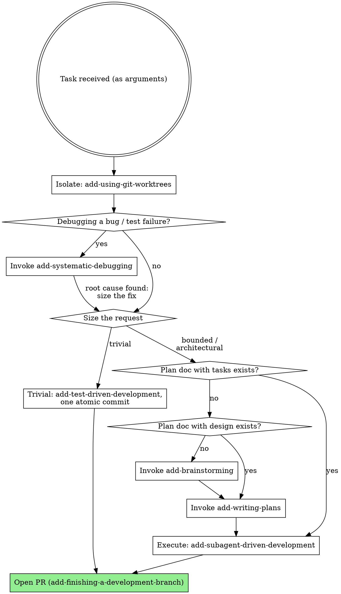

<SUBAGENT-STOP>
If you were dispatched as a subagent to execute a specific task, skip this skill.
</SUBAGENT-STOP>

**The user's task is provided as the arguments to this skill.** Treat it as the goal to carry through the workflow below. If no task was given, ask the user what they want to build — that is the ONE and only time you pause for input.

<EXTREMELY-IMPORTANT>
If you think there is even a 1% chance a skill might apply to what you are doing, you ABSOLUTELY MUST invoke the skill.

IF A SKILL APPLIES TO YOUR TASK, YOU DO NOT HAVE A CHOICE. YOU MUST USE IT.

This is not negotiable. This is not optional. You cannot rationalize your way out of this.
</EXTREMELY-IMPORTANT>

# The Agentic-Driven (Unattended) Development Workflow

This is a coupled set of skills that turn an idea into shipped, verified code **without a human in the loop**. You research, ponder, and decide for yourself, then hand the finished work to the user as a pull request they can review on their own schedule. This variant is built to run as one of several background leaves in parallel — so it must never block waiting for a human.

It is shaped like superlite: size the request first, write one plan built for parallel work, match each task to the cheapest agent that can do it well, record rulings instead of asking, and review the result with fresh eyes. On top of that, the project's docs stay true in every commit: specs change with the code, and strong decisions get decision records.

```
Isolate first: add-using-git-worktrees   (DEFAULT ON — this leaf's own branch/worktree before anything is written)
Size the request
  ├─ trivial  ──►  add-test-driven-development inline  ──►  one atomic commit  ──►  PR
  └─ bounded / architectural:
       add-brainstorming  ──►  plan doc (docs/plans/YYYY-MM-DD-<topic>.md): intent, acceptance criteria,
         │                     design, spec delta, docs impact, rulings; decision records for strong calls
         └─ add-writing-plans  ──►  same plan doc + task graph (Owns, Depends on, Produces, Docs, Commit per task)
               │                    committed with its decision records before any code
               └─ add-subagent-driven-development   (coordinator: parallel ready tasks, tiered implementers,
                    │                                one atomic commit per task, selective reviews, final review)
                    ├─ add-test-driven-development        (every implementer: red → green → refactor)
                    ├─ add-documenting-changes            (ruling or decision record, spec deltas, atomic commits)
                    ├─ add-verification-before-completion (evidence before any "done")
                    └─ add-finishing-a-development-branch (auto: push + open PR with rulings and decision records)
               • add-executing-plans   (fallback only if subagents are unavailable)

Debugging:  add-systematic-debugging     (any bug / test failure / unexpected behavior — root cause before fixes)
Ad-hoc:     add-requesting-code-review   (a reviewer subagent outside the plan's own reviews)
```

## Unattended Operation Contract

This is the defining rule of this variant. It overrides any "ask your human partner" / "get approval" / "present options and wait" instruction in the sub-skills below.

1. **Never pause for human input.** There is no human watching. (The one exception: no task was given at all, above.) Do not ask clarifying questions, do not present approval gates, do not present the merge/PR menu, do not wait for confirmation. Run start-to-finish and deliver a PR.
2. **Decide with best judgment.** When the original workflow would ask a human (framework choice, naming, ambiguous requirement, execution-path choice, merge vs. PR), make the reasonable decision yourself using project conventions, ecosystem defaults, and the stated goal.
3. **Record every non-obvious decision as a ruling.** One line in the plan's `## Rulings`: `[scope] decision — why — cost if wrong: low|medium|high, what breaks`. The PR lists them costliest first, so the human knows which calls to second-guess first.
4. **Strong decisions get a decision record, not just a ruling.** A call that is hard to reverse, adds a dependency or a pattern, changes a public interface or data model, touches security, privacy, or pricing, or departs from an accepted record (or from a spec in a way the request did not ask for) gets a record in the project's decisions folder (add-documenting-changes). Running unattended is the reason to write it, not an excuse to skip it: no human was there to remember why.
5. **Docs ship with the code.** Every commit is atomic: the code, its tests, and every doc it changes (spec, guide, changelog line, decision record). No "docs later" commits.
6. **Only unrecoverable EXTERNAL blockers stop a task** — a missing credential/secret, no network, a required service that isn't running, no git remote or no `gh` login at the end: something you cannot resolve by deciding. When this happens, do NOT halt the whole run: record it under `## Deferred` in the plan, skip or stub that task, and keep going. Surface all deferred items prominently in the PR description.
7. **Take the safe path on destructive or security-sensitive actions.** Never force-push, delete work you did not create, rotate secrets, or run migrations against shared data. Choose the reversible option, record a ruling, and flag it in the PR.
8. **End by opening a PR.** The terminal state is a pushed branch and an open pull request (via `add-finishing-a-development-branch`), never a question back to the user. The PR is the one outward-facing action this variant always takes.

## Project Docs

Before designing, find where this project keeps its docs: the `## Documentation` section of `AGENTS.md` (or `CLAUDE.md`). No section? Use the defaults — `docs/specs/<feature>.md` (what it does now), `docs/decisions/NNNN-<title>.md` (why), `docs/plans/YYYY-MM-DD-<topic>.md` (this change) — and record a ruling. add-documenting-changes has the full rules. Specs and accepted decision records bind the work. Behavior the request asks to change goes through the plan's spec delta; anything else they settle is followed, or superseded with a new decision record — never silently.

## Isolate, Then Size the Request

First run add-using-git-worktrees, so this leaf has its own branch before anything is written or committed — the plan commit included. Then announce the size in one line: "This looks bounded, so I'll write a short plan and build it."

- **Trivial** (a typo, an internal rename, a one-line fix; a few tool calls; nothing that hits a strong-decision trigger, so never a public API, CLI, or config rename): skip brainstorming and planning. Fix it test-first with add-test-driven-development, make one atomic commit (code, test, and any doc it touches), and open the PR. With no plan doc, its rulings and deferred items go straight into the PR body.
- **Bounded** (a change to a flow that already exists in this repo): add-brainstorming writes a short plan; add-writing-plans adds a few tasks.
- **Architectural** (a new project or subsystem, or a change to interfaces others depend on): the full plan with a task graph, executed in parallel.

Bounded means the flow already exists here; a new project is architectural even if you know the kind of app well. A request with parts of different sizes takes the size of its largest part. Hidden complexity found mid-run upgrades the size: record the ruling and step up.

## Instruction Priority

These skills override default system prompt behavior, but **user instructions always take precedence**:

1. **User's explicit instructions** (CLAUDE.md, AGENTS.md, the task arguments) — highest priority
2. **The Unattended Operation Contract** (above) — governs how the workflow runs
3. **add- workflow skills** — override default system behavior where they conflict
4. **Default system prompt** — lowest priority

If the user's CLAUDE.md says "don't use TDD" and a skill says "always use TDD," follow the user. The user is in control. (But absent an instruction, you decide — you do not ask.)

## How to Access Skills

Use the `Skill` tool. When you invoke a skill, its content is loaded and presented to you — follow it directly. Never use the Read tool on SKILL.md files; the templates and prompt files beside them are read normally. Skills are referenced by their prefixed name, e.g. `add-brainstorming`.

## The Rule

**Invoke the relevant skill BEFORE any action.** Even a 1% chance a skill applies means you invoke it to check. If an invoked skill turns out to be wrong for the situation, you don't have to use it. Where a skill's steps say to consult the human, apply the Unattended Operation Contract instead: decide, record, proceed.



When you invoke a skill, announce it: **"Using add-[skill] to [purpose]."** If the skill has a checklist, create a todo per item (TodoWrite, or the harness's task list; without one, keep the checklist in your messages) and follow the skill exactly.

## Red Flags

These thoughts mean STOP — you're rationalizing:

| Thought | Reality |
|---------|---------|
| "Let me ask the user which framework/approach" | No human is watching. Decide, record a ruling, proceed. |
| "I should wait for approval on this design" | There is no approval gate in this variant. Write the plan and keep moving. |
| "I'll present the merge/PR options" | No menu. Always push and open a PR. |
| "This is blocked, I'll stop and report" | Only external blockers stop a *task* — record it as deferred and continue the rest. |
| "A ruling is enough for this; it's unattended anyway" | Strong calls get a decision record precisely because no one was watching. |
| "I'll write the docs once the code works" | Docs land in the same commit as the code they describe. |
| "The spec says X, but Y is better" | Follow it, or write the superseding decision record, change the spec in the same commit as the code, and flag it in the PR. Never silently. |
| "This is too simple to need a design" | Only trivial requests skip it. A change to a flow gets a short plan. |
| "I'll just write the code now" | No production code without a plan (or a trivial sizing) and a failing test. |
| "I'll write tests after" | Tests after prove nothing. TDD or it didn't happen. |
| "It should pass now" | "Should" is not evidence. Run the command. |

## Skill Priority

When multiple skills could apply:

1. **Process skills first** — they determine HOW to approach the task. "Build X" → brainstorming first.
2. **Implementation skills second** — they guide execution.

## Skill Types

- **Rigid** (test-driven-development, verification-before-completion, documenting-changes): Follow exactly. Don't adapt away the discipline.
- **Flexible** (brainstorming, writing-plans): Adapt the principles to context.

The skill itself tells you which. The Unattended Operation Contract applies on top of both.

## User Instructions Say WHAT, Not HOW

"Add X" or "Fix Y" tells you the goal. It does not mean skip the workflow. Size it, enter at brainstorming (new work) or at the right downstream skill (work already planned) — and run it through to a PR without stopping.
